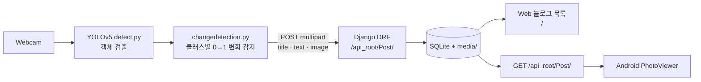

# AI Intrusion Detection

YOLOv5로 카메라 영상에서 객체 출현을 감지하고, 검출 이미지를 Django 블로그 서버에 자동 등록한 뒤 Android 앱에서 확인하는 **Edge–Server–Mobile 연동 프로젝트**입니다.
모바일/웹서비스 프로젝트 **공통평가 02** (Ch08. Django와 YOLO를 이용한 침입자 감시 시스템) 과제입니다.

- Cloud Server: <https://hoynola.pythonanywhere.com>
- REST API: <https://hoynola.pythonanywhere.com/api_root/Post/>
- Django 서버와 Android 앱은 공통평가 01 저장소 [Mobile-Webservice](https://github.com/Moon-Eavan/Mobile-Webservice)의 코드를 재사용합니다.

> **진행 상태 (2026-11-03):** Phase 0·1 완료, Phase 2 코드 완료 — `changedetection.py` 작성·`detect.py` 연동, 샘플 이미지로 Django 자동 등록 확인. 다음: ID 4 캡처 후 웹캠 로컬 연동(Phase 3).
> 단계별 상태는 [`docs/IMPLEMENTATION_PLAN.md`](docs/IMPLEMENTATION_PLAN.md)를 참고하세요.

## Architecture



- 매 프레임이 아니라, 이전 프레임에 없던 클래스가 새로 나타났을 때(0→1)만 전송합니다.
- 같은 클래스의 여러 객체는 하나로 취급하며, 개체 추적·신원 식별은 하지 않습니다.

## Project Structure

```text
AI-Intrusion-Detection/
├── PhotoBlogServer/   # Django 4.2 + DRF 서버 (mysite / blog)
├── PhotoViewer/       # Android Java 클라이언트 (com.example.photoviewer)
├── YOLOv5/            # Edge Client: upstream YOLOv5 (e128e59) + changedetection.py
├── docs/              # 요구사항·계획·연동 가이드·체크리스트
├── tools/             # 공통평가 01 Raw Socket 요청 확인 도구
└── 모바일웹서비스 프로젝트_공통평가 02_수행 결과 보고서.docx
```

자세한 파일 역할은 [`docs/PROJECT_STRUCTURE.md`](docs/PROJECT_STRUCTURE.md).

## Tech Stack

| 구성 | 기술 |
| --- | --- |
| Edge | YOLOv5 (PyTorch), OpenCV, requests — Python 3.9 |
| Server | Django 4.2.30, Django REST framework 3.16.1, SQLite, Pillow |
| Mobile | Android Java 11 (minSdk 24 / targetSdk 36), RecyclerView, Room, WorkManager |
| Cloud | PythonAnywhere |

## REST API

| Method | Endpoint | 설명 |
| --- | --- | --- |
| `GET` | `/api_root/Post/` | 게시물 목록 JSON (`author, title, text, created_date, published_date, image`) |
| `POST` | `/api_root/Post/` | multipart `title`, `text`, `image` 등록 (`author`는 서버가 지정) |
| `GET` | `/` | 웹 게시물 목록 |
| `GET` | `/post/<id>/` | 웹 게시물 상세 |
| `GET` | `/admin/` | Django 관리자 |

YOLOv5는 검출 클래스명을 `title`, 새로 나타난 클래스 목록을 `text`, 바운딩 박스가 그려진 프레임(320×240)을 `image`로 전송합니다.

## Getting Started

### 1. Django Server

```bash
cd PhotoBlogServer
python3 -m venv venv
source venv/bin/activate
pip install -r requirements.txt
python manage.py migrate
python manage.py createsuperuser   # 관리자/웹 작성용 (선택)
python manage.py runserver
```

- Web: <http://127.0.0.1:8000/> · API: <http://127.0.0.1:8000/api_root/Post/>
- `localhost`는 `ALLOWED_HOSTS`에 없으므로 `127.0.0.1`로 접속합니다.
- 테스트: `python manage.py test blog`

### 2. YOLOv5 Edge Client

```bash
# 이 저장소에는 YOLOv5/가 이미 포함되어 있다 (upstream e128e59, .git 제거)
cd YOLOv5
python3.9 -m venv venv
source venv/bin/activate
pip install -r requirements.txt -c <(echo "numpy<2")   # Intel Mac(torch 2.2.2)은 numpy 2 비호환
python detect.py --source 0                     # 기본 검출 (카메라 필요)
```

macOS에서 `not authorized to capture video` / `Failed to open 0`이 나오면 시스템 설정 → 개인정보 보호 및 보안 → 카메라에서 터미널 앱을 허용하고 터미널을 재시작합니다.
첫 실행 시 `yolov5s.pt`(14MB)가 자동으로 내려받아지며, 결과는 `runs/detect/expN/`에 저장됩니다(둘 다 Git 제외).

`changedetection.py` 연동 후에는 서버 주소를 환경변수로 지정해 실행합니다.

```bash
PHOTOBLOG_HOST=http://127.0.0.1:8000 python detect.py --source 0              # 로컬
PHOTOBLOG_HOST=https://hoynola.pythonanywhere.com python detect.py --source 0 # Cloud
```

연동 방법은 [`docs/YOLOV5_INTEGRATION.md`](docs/YOLOV5_INTEGRATION.md).

### 3. Android Client

1. Android Studio에서 `PhotoViewer/`를 엽니다.
2. 서버 주소는 `ApiConfig.java`의 `BASE_URL` 한 곳에서 관리합니다.
   - Cloud (기본): `https://hoynola.pythonanywhere.com`
   - 에뮬레이터 → 로컬 서버: `http://10.0.2.2:8000`
3. 실행 후 동기화 버튼을 누르면 YOLO가 등록한 게시물과 이미지가 목록에 표시됩니다.

## 공통평가 02 제출 항목

| ID | 항목 | 증빙 |
| --- | --- | --- |
| 1 | 폴더 구조 | 루트 구조 캡처 |
| 2 | GitHub push | 이 저장소 URL |
| 3 | YOLOv5 설치 및 실행 | 수정 전 `detect.py` 실행·인식 화면 |
| 4 | 검출기 코드 수정 | `changedetection.py`, `detect.py` VS Code 화면 |
| 5–6 | 블로그 등록 결과 (localhost) | `api_root`, 목록·이미지 |
| 7 | 모바일 화면 확인 | YOLO 전송 이미지가 보이는 Android 화면 |
| 8–9 | PythonAnywhere 동작 | Cloud `api_root`, 목록·이미지 |
| 10 | 기획되지 않은 편의 기능 (2개) | 원격 감시 설정, 이벤트 클립 녹화 + 보관 정책 |

## 추가 기능 (ID 10)

| 기능 | 내용 |
| --- | --- |
| **원격 감시 설정** | Android에서 감시 ON/OFF, 감시 대상 클래스(COCO 80개 중 선택), 신뢰도 임계값, 재등록 대기시간을 바꾸면 YOLO Edge가 polling으로 수 초 내 반영. 앱에서 Edge 온라인 상태 확인 |
| **이벤트 클립 녹화 + 보관 정책** | 객체 출현 시 감지 전후 3초를 H.264 클립으로 만들어 게시물과 함께 업로드, 웹·Android에서 재생. 클립 총용량이 상한(기본 200MB)을 넘으면 오래된 클립부터 자동 삭제 |

설계: [`docs/EXTRA_FEATURES.md`](docs/EXTRA_FEATURES.md) (구현 예정)

상세 기준은 [`docs/ASSIGNMENT.md`](docs/ASSIGNMENT.md), 캡처 체크리스트는 [`docs/REPORT_CHECKLIST.md`](docs/REPORT_CHECKLIST.md).

## Security & Repository Notes

- 이 저장소의 `settings.py`는 `SECRET_KEY`를 `DJANGO_SECRET_KEY`, 디버그를 `DJANGO_DEBUG` 환경변수로 설정합니다 (`DEBUG=False`에서 키가 없으면 실행 중단).
  PythonAnywhere에서 동작 중인 서버는 아직 이전 버전 설정(하드코딩된 `SECRET_KEY`, `DEBUG = True`)이며, 다음 배포 때 환경변수 방식으로 전환할 예정입니다.
- 게시물 API는 인증 없이 POST할 수 있습니다(강의 실습 범위). 강의자료의 JWT 예제 계정·토큰은 저장소에 넣지 않습니다.
- Git 제외: `venv/`, `.env`, `db.sqlite3`, `media/`, `.coverage`, `htmlcov/`, `staticfiles/`, Android 빌드 산출물, YOLOv5 `venv/`·`*.pt`·`runs/*` (upstream `YOLOv5/.gitignore`)
